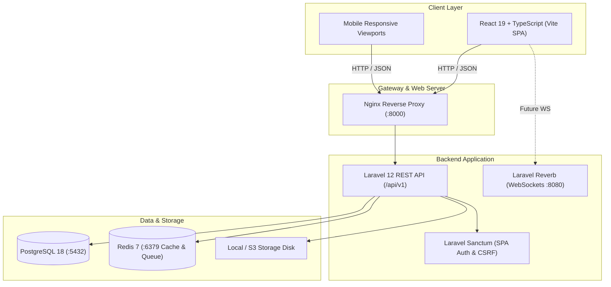

# MegaCommerce System Architecture (Phase 1)

## 1. High-Level Architecture Overview

MegaCommerce is engineered as an enterprise-grade, multi-vendor e-commerce platform designed for horizontal scalability, modular microservices readiness, and high transaction concurrency.

## 2. Technology Stack

- **Backend:** PHP 8.2+ / Laravel 12 (REST API `/api/v1`)
- **Database:** PostgreSQL 18 with relational indexes and constraints
- **Cache & Message Broker:** Redis 7 / Predis
- **Frontend:** React 19 + TypeScript powered by Vite
- **Styling & Components:** Tailwind CSS v3 + Radix UI / shadcn/ui design tokens
- **State & Data Fetching:** Zustand, TanStack Query v5, Axios
- **Form Handling:** React Hook Form + Zod schema validation
- **DevOps:** Docker Compose (multi-service orchestration)

## 3. Security & Multi-Vendor Roles Matrix

The platform is anchored on 6 distinct role archetypes:

| Role Code | Purpose | Access Scope |
| :--- | :--- | :--- |
| `SUPER_ADMIN` | Root Infrastructure | Unrestricted platform control |
| `ADMIN` | Platform Administration | Vendor approval, catalog dispute, compliance |
| `STAFF` | Operations & Catalog Desk | Product moderation, customer tickets, translation |
| `SELLER` | Multi-Vendor Merchant | Product listings, vendor orders, Bakong payouts |
| `CUSTOMER` | End-Buyer | Browsing, cart, checkout, reviews, wishlist |
| `DELIVERY_DRIVER` | Logistics & Dispatch | Delivery route fulfillment, drop-off confirmation |

## 4. Phase Roadmap

- **Phase 1 (Active):** Project foundation, Laravel API `/api/v1`, PostgreSQL migrations & seeders, health endpoints, React design system, public storefront layout, auth UI forms with Zod, role dashboard layout shells, Docker Compose, automated tests.
- **Phase 2 (Next):** Sanctum session authentication, customer registration & login token exchange, Bakong KHQR checkout integration, real-time Reverb WebSocket events, interactive GPS driver routing, and vendor KYC onboarding.

