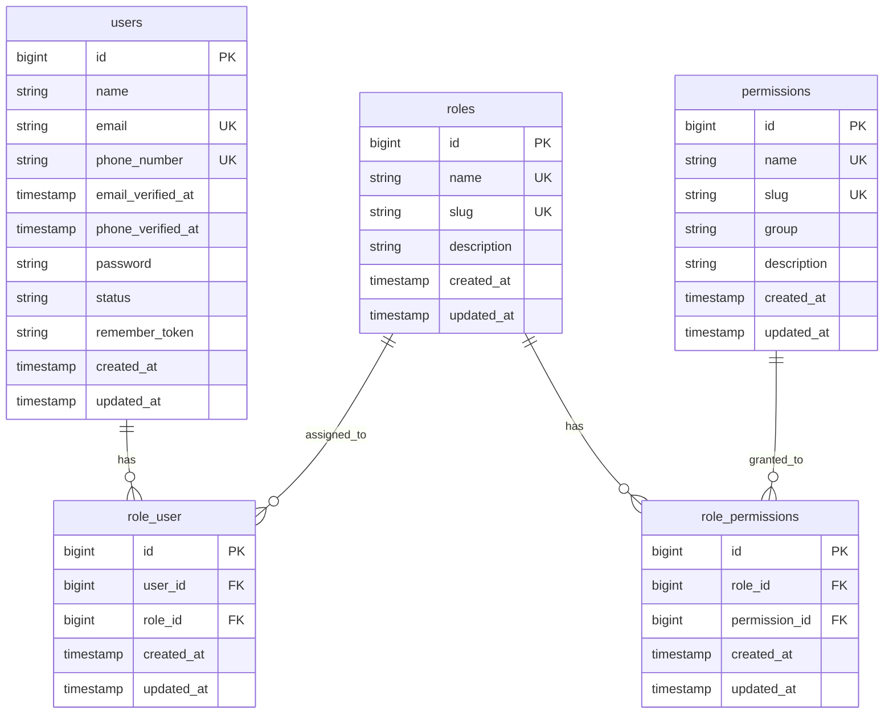

# MegaCommerce Database Schema (Phase 1)

## 1. Relational ER Diagram

## 2. Table Specifications & Constraints

### `users`
- Primary Key: `id` (bigserial)
- Unique: `email`, `phone_number`
- Indexes: `status`
- Timestamps: `created_at`, `updated_at`

### `roles`
- Primary Key: `id` (bigserial)
- Unique: `name`, `slug`
- Initial Seeded Roles: `SUPER_ADMIN`, `ADMIN`, `STAFF`, `SELLER`, `CUSTOMER`, `DELIVERY_DRIVER`

### `permissions`
- Primary Key: `id` (bigserial)
- Unique: `name`, `slug`
- Index: `group`

### `role_user` (Pivot)
- Foreign Keys: `user_id -> users(id) ON DELETE CASCADE`, `role_id -> roles(id) ON DELETE CASCADE`
- Composite Unique Constraint: `(user_id, role_id)`

### `role_permissions` (Pivot)
- Foreign Keys: `role_id -> roles(id) ON DELETE CASCADE`, `permission_id -> permissions(id) ON DELETE CASCADE`
- Composite Unique Constraint: `(role_id, permission_id)`

